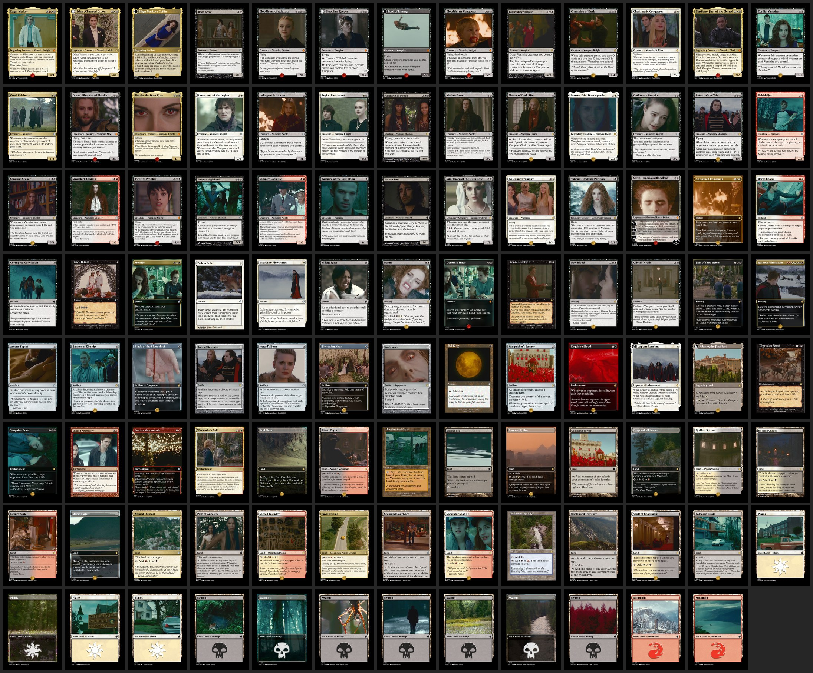

# Twilight Markov

A 100-card Edgar Markov Commander deck where every card is a screen cap from one of the *Twilight* films. Files are print-ready proxies: you can print yourself or use your preffered provider. I used [MakePlayingCards.com](https://www.makeplayingcards.com).

Fan-made for personal use. Not affiliated with Wizards of the Coast or Summit Entertainment. Not for sale.

## Files

- `cards/`: one PNG per card face, 2210×3014 px with bleed already included. These are the files you upload.
- `cards/zzcardback-brown-v2-print.png`: the shared card back.
- `proofs/` and `_deck.jpg`: preview sheets only. Don't upload these.

## Double-sided cards

These three cards have a unique back instead of the shared card back:

| Front | Back |
| --- | --- |
| `aaedgar-charmed-groom.png` | `zzedgar-charmed-groom-back.png` |
| `aalegion-s-landing.png` | `zzlegion-s-landing-back.png` |
| `aabloodline-keeper.png` | `zzbloodline-keeper-back.png` |

The `aa`/`zz` prefixes sort the fronts first and the backs last, so the three double-sided cards land in slots 1–3.

## Printing at MakePlayingCards.com

1. Choose **Game Cards → Poker size (63 × 88 mm)** and the quantity tier that covers 100 cards. For stock, we used **(S33) Superior Smooth**, but **(S30) Standard Smooth** also works.
2. **Front:** choose *different images*, upload every PNG in `cards/` except the `zz…` files, and autofill. That gives 100 fronts.
3. **Back:** choose *different images*. Upload `zzcardback-brown-v2-print.png` and the three `zz…-back.png` files. Put each DFC back behind its front in slots 1–3, and fill the other 97 slots with the card back.
4. Check the preview, then order.

When we ordered, the deck cost me **£28.35 before shipping** your milage may vary.
